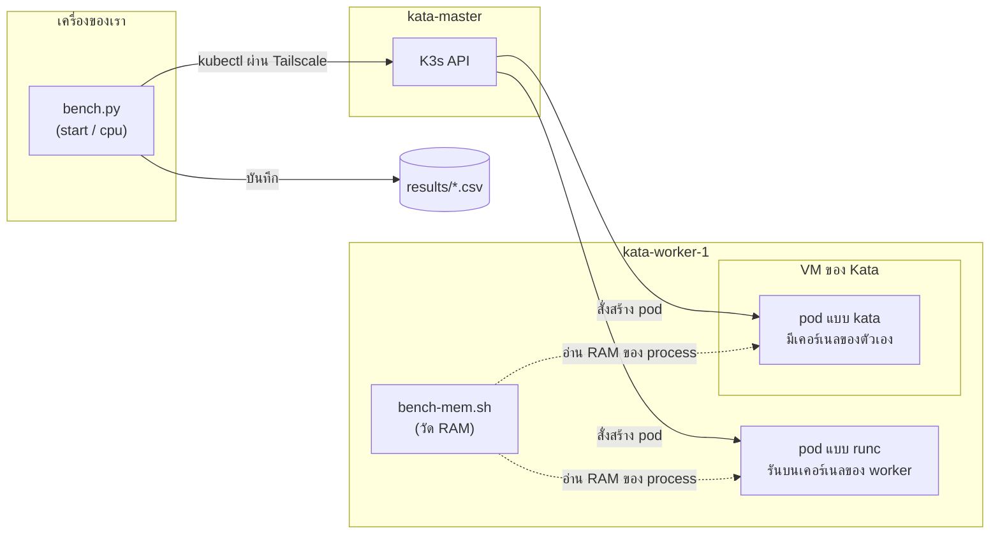

# bench — วัดผล runc เทียบกับ Kata (หัวข้อ B3)

เราวัด 3 อย่างเพื่อดูว่า Kata ต้อง "จ่าย" อะไรบ้างแลกกับความปลอดภัยที่เพิ่มขึ้น

| วัดอะไร | สคริปต์ | ใครรัน | รันที่ไหน |
|---|---|---|---|
| เวลาเริ่ม pod | `bench.py start` | pooad | เครื่องตัวเอง (Windows/Mac/Linux) |
| ความเร็ว CPU | `bench.py cpu` | pooad | เครื่องตัวเอง |
| RAM ที่ใช้จริง | `bench-mem.sh` | james | worker (ต้องใช้ SSH) |

## ระบบทำงานอย่างไร



`bench.py` สั่งสร้าง pod ผ่าน kubectl แล้วจับเวลา ส่วน RAM ต้องดูจากในเครื่อง worker โดยตรง จึงใช้ `bench-mem.sh` ที่รันบน worker

## ใช้งาน `bench.py` (pooad)

สิ่งที่ต้องมีคือ Python 3 และ kubeconfig ของตัวเอง (บน Windows ติดตั้ง Python ด้วย `winget install -e --id Python.Python.3.12`)

```bash
python3 bench.py start runc      # Windows พิมพ์ python แทน python3
python3 bench.py start kata
python3 bench.py cpu runc
python3 bench.py cpu kata
```

ค่าตั้งต้นคือ start 10 รอบ และ cpu 5 รอบ ถ้าต้องการกำหนดเอง ให้ใส่ `-n` ตามด้วย namespace และใส่จำนวนรอบต่อท้าย เช่น `python3 bench.py start kata 20 -n dev-pooad`

สคริปต์จะแสดงค่า mean/min/max/SD และบันทึกผลลง `results/<test>-<runtime>-<เวลา>.csv` ถ้ารันพังหรือกด Ctrl+C จะไม่บันทึกผล

## ใช้งาน `bench-mem.sh` (james)

```bash
# 1) Mac: สร้าง pod 1 ตัว (ถ้าวัด kata ให้เพิ่ม --overrides)
kubectl run mem-test -n dev-james --image=nginx:alpine \
  --overrides='{"spec":{"runtimeClassName":"kata"}}'
kubectl wait -n dev-james --for=condition=Ready pod/mem-test

# 2) worker: ssh เข้าไป รอจนขึ้น prompt แล้วรัน
./bench-mem.sh kata        # หรือ runc

# 3) Mac: ลบ pod
kubectl delete pod mem-test -n dev-james
```

ระหว่างวัด บน worker ต้องมี pod แบบที่วัด**รันอยู่ตัวเดียว** ถ้าหา process ไม่เจอ สคริปต์จะหยุดโดยไม่บันทึกผล

## ผลทดลองเบื้องต้น (ยังไม่ใช่ผลจริงสำหรับรายงาน)

| | runc | kata | สรุป |
|---|---|---|---|
| เวลาเริ่ม pod | ~2.2 s | ~3.6 s | kata ช้ากว่า ~1.4 s เพราะต้องบูต VM |
| CPU (md5 1 GB) | ~6.3 s | ~6.0 s | ใกล้เคียงกัน ยังสรุปไม่ได้ |
| RAM | 11.9 MB | 279.1 MB | kata ใช้มากกว่า ~23 เท่า |

## กติกา
- ห้าม commit kubeconfig, `.pem` หรือ token ขึ้น GitHub
- ระหว่างวัด อย่ารันงานหนักอื่นบน cluster
- ถ้าเจอ error `localhost:8080` แปลว่ารัน kubectl ผิดเครื่อง ให้รันบนเครื่องตัวเองหรือ master