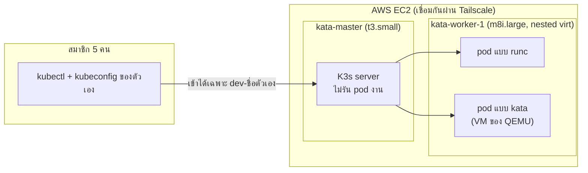

# infra — การตั้งค่าระบบ (Infrastructure as Code)

ไฟล์ในโฟลเดอร์นี้คือ**ต้นฉบับ**ของการตั้งค่าใน cluster ถ้า cluster พังหรือต้องสร้างใหม่ ให้ใช้ไฟล์เหล่านี้สร้างคืนได้ทันที

## ระบบของเรา



| ส่วนประกอบ | เวอร์ชัน |
|---|---|
| K3s | v1.37.2+k3s1 |
| Kata Containers | 4.1.0 (runtime-rs + QEMU) |
| Guest kernel | 6.18.35 |

## ไฟล์ใน `k8s/`

| ไฟล์ | ข้างในมีอะไร |
|---|---|
| `runtimeclass.yaml` | ตัวเลือก `kata` ซึ่งนับ overhead ของ VM ไว้ที่ 100m CPU / 160Mi RAM และส่ง pod ไปรันเฉพาะเครื่องที่มี Kata |
| `namespaces.yaml` | ห้อง `dev-pete`, `dev-mawn`, `dev-james`, `dev-film`, `dev-pooad` แต่ละห้องมีโควตาและค่า default |
| `rbac.yaml` | บัญชีของสมาชิกแต่ละคน มีสิทธิ์ `edit` เฉพาะในห้องของตัวเอง |

**โควตาของแต่ละห้อง:** สูงสุด 5 pod, CPU ที่จองรวม 400m และ RAM 1Gi
**ค่า default ต่อ container:** จอง 50m / 128Mi และเพดาน 500m / 256Mi

## วิธีใช้ (เฉพาะผู้ดูแลระบบ)

```bash
kubectl diff  -f infra/k8s/    # เทียบไฟล์กับระบบ ถ้าไม่มีผลออกมา แปลว่าตรงกัน
kubectl apply -f infra/k8s/    # สร้างหรืออัปเดตระบบให้ตรงกับไฟล์
```

**กติกา:** ถ้าจะเปลี่ยนการตั้งค่า ให้แก้ไฟล์ในนี้ก่อน แล้วเปิด PR และ `apply` หลังจาก merge แล้ว ห้ามแก้ใน cluster ตรง ๆ เพราะไฟล์กับระบบจะไม่ตรงกัน

## สิ่งที่ไม่ได้เก็บไว้ที่นี่ (ของลับ)
- token และ kubeconfig ของสมาชิก ซึ่งส่งให้ทางแชทส่วนตัวเท่านั้น
- SSH key (`.pem`)
- K3s node-token (ในเอกสารให้เขียนเป็น `<token>` แทนค่าจริง)

ขั้นตอนติดตั้ง K3s และ Kata ตั้งแต่ต้นอยู่ในเอกสารของทีม หัวข้อ B1