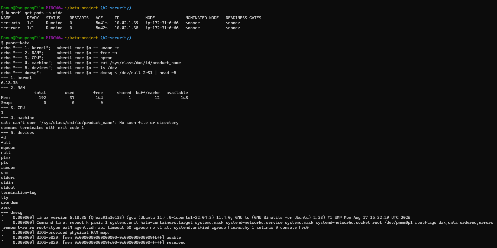
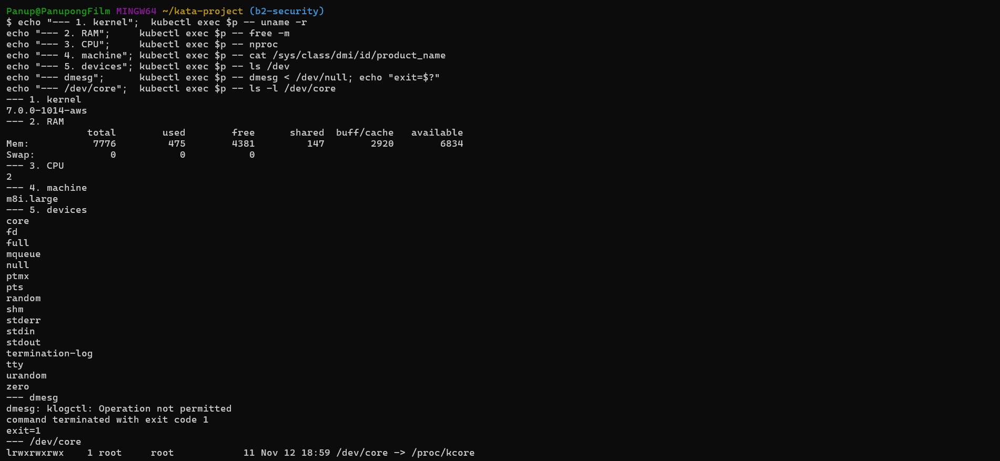
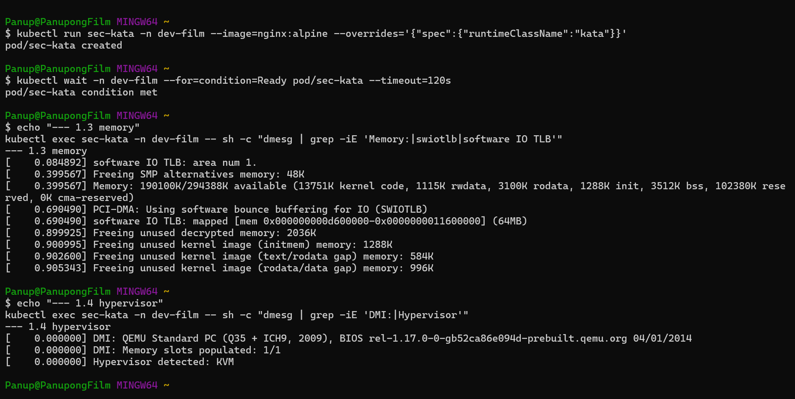

# B2 Security: ลองดูว่า pod มองเห็นอะไรบ้าง (runc vs Kata)

ทดสอบโดย film วันที่ 13 พ.ย. 2569 ใน namespace `dev-film`

## ทำอะไรไปบ้าง

สร้าง pod `nginx:alpine` ขึ้นมา 2 ตัว ตัวหนึ่งเป็น runc ธรรมดา อีกตัวเป็น Kata นอกนั้นเหมือนกันหมด แล้วเข้าไปรันคำสั่งเดียวกันในทั้งสองตัว เพื่อดูว่าจากในตัว pod จะมองออกมาเห็นเครื่อง worker ได้แค่ไหน

```bash
kubectl run sec-runc -n dev-film --image=nginx:alpine
kubectl run sec-kata -n dev-film --image=nginx:alpine --overrides='{"spec":{"runtimeClassName":"kata"}}'
kubectl wait -n dev-film --for=condition=Ready pod/sec-runc pod/sec-kata
```

ทั้งสองตัวไปลงที่ node `ip-172-31-6-66` เหมือนกัน (เป็น worker ตัวเดียวที่เรามี) เลยเทียบกันได้ตรง ๆ

## ผลที่ได้

| # | ดูอะไร | คำสั่ง | runc | Kata |
|---|---|---|---|---|
| 1 | เคอร์เนล | `uname -r` | `7.0.0-1014-aws` | `6.18.35` |
| 2 | RAM | `free -m` | 7776 MB | 192 MB |
| 3 | CPU | `nproc` | 2 | 1 |
| 4 | รุ่นเครื่อง | `cat /sys/class/dmi/id/product_name` | `m8i.large` | ไม่มีไฟล์นี้ |
| 5 | อุปกรณ์ | `ls /dev` | 16 ตัว | 15 ตัว |
| + | log เคอร์เนล | `dmesg` | `Operation not permitted` | อ่านได้ (เป็น log ของ VM) |

ข้อ 5 สองฝั่งเหมือนกันเกือบหมด (`fd full mqueue null ptmx pts random shm stderr stdin stdout termination-log tty urandom zero`) ต่างกันแค่ runc มี `core` เพิ่มมาตัวเดียว ซึ่งเป็น symlink `/dev/core -> /proc/kcore`

## แปลว่าอะไร

1. **เคอร์เนล:** runc ใช้เคอร์เนลตัวเดียวกับเครื่อง ถ้าเคอร์เนลมีช่องโหว่ คนที่อยู่ใน pod ก็มีโอกาสหลุดออกมาถึงเครื่องได้ ส่วน Kata มีเคอร์เนลของตัวเองใน VM ถ้าจะออกมาต้องเจาะ VM ให้ได้ก่อน
2. **RAM:** runc เห็น RAM ทั้งเครื่อง แต่ Kata เห็นแค่ของ VM ตัวเอง คือไม่รู้เลยว่าเครื่องจริงมี RAM เท่าไร ทั้งนี้ runc แค่ "เห็น" 7776 MB เท่านั้น ใช้ได้จริงไม่เกิน limit ที่ cgroup กำหนดไว้ (256Mi ตาม LimitRange ของห้อง)
3. **CPU:** เหมือนข้อ 2 คือ runc เห็นทั้ง 2 core ของเครื่อง ส่วน Kata เห็นแค่ 1 core ที่ VM ได้มา
4. **รุ่นเครื่อง:** จาก runc รู้ได้เลยว่ารันอยู่บน EC2 `m8i.large` ซึ่งคนโจมตีเอาไปใช้เลือกช่องโหว่ได้ ส่วนฝั่ง Kata อ่านไม่ได้เพราะ VM ไม่มีข้อมูลส่วนนี้ให้
5. **อุปกรณ์:** runc สร้าง symlink `/dev/core` ไว้ตามธรรมเนียมของ runtime แต่ปลายทาง (`/proc/kcore`) ถูกปิดกั้นไว้ อ่านไม่ได้อยู่แล้ว ส่วน Kata ไม่มี symlink นี้ เป็นความต่างเล็กน้อย ไม่ใช่ช่องโหว่
6. **dmesg:** runc โดนห้าม ส่วน Kata อ่านได้ ตอนแรกดูเหมือนแย่ แต่พอดูข้างในแล้วเป็น log ตอนบูตของ VM เอง (`Linux version 6.18.35 ... kata-containers.target`) ไม่ใช่ของเครื่อง worker เลยกลายเป็นหลักฐานอีกอันว่า Kata มีเคอร์เนลแยกของตัวเองจริง แต่ใน log เดียวกันก็มีบรรทัด `DMI: QEMU Standard PC (Q35 + ICH9, 2009)` กับ `Hypervisor detected: KVM` แปลว่า Kata ซ่อนข้อมูลของเครื่อง worker ได้ แต่ไม่ได้ซ่อนว่าตัวเองเป็น VM เพราะ pod อ่าน log ของ VM แล้วรู้ได้ว่ารันบน QEMU/KVM

สรุปคือ Kata เพิ่มชั้นกั้นขึ้นมาอีกชั้นระหว่าง pod กับเครื่อง และทำให้ pod รู้เรื่องเครื่องจริงน้อยลง แต่ไม่ได้แปลว่าปลอดภัย 100% ถ้ามีช่องโหว่ใน VM หรือ qemu ก็ยังทะลุออกมาได้ แค่ยากขึ้น

```
runc:  [nginx] ── เคอร์เนล worker (ใช้ร่วมกัน) ── เครื่อง
kata:  [nginx] ── เคอร์เนล VM ── qemu ── เคอร์เนล worker ── เครื่อง
                  └─ ชั้นกั้นที่เพิ่มขึ้น ─┘
```

## ที่ไม่ตรงกับที่คาดไว้ใน issue

- **RAM ฝั่ง runc** ได้ 7776 MB ไม่ใช่ ~7,6xx ตามที่คาด
- **RAM ฝั่ง Kata** ได้ 192 MB ซึ่งยังต่ำกว่า 300 ตามที่คาด แต่น้อยกว่า 288 MB ที่ james เห็นจากฝั่ง worker พอไปดู `dmesg` ของ VM (ภาพ `Kata_dmesg.png`) ได้บรรทัดนี้

  ```
  Memory: 190100K/294388K available (13751K kernel code, ..., 102380K reserved, ...)
  software IO TLB: mapped [...] (64MB)
  ```

  VM มี RAM ทั้งหมด 294388K (≈ 288 MB ตรงกับที่ james เห็น) เคอร์เนลกันไว้ 102380K (≈ 100 MB) ในนั้นเป็น buffer SWIOTLB ไว้รับส่งข้อมูลกับอุปกรณ์ 64 MB ตัวเคอร์เนลเองราว 22 MB ที่เหลือราว 14 MB ยังไม่ได้แยกว่าเป็นอะไร ตอนบูตเสร็จเหลือใช้ได้ 190100K (≈ 186 MB) แล้วเคอร์เนลคืนหน่วยความจำส่วนที่ใช้ตอนบูตกลับมาอีกราว 5 MB เลยออกมาใกล้ ๆ 192 MB ที่ `free` เห็น
- **ข้อ 4 ฝั่ง Kata** ไม่ได้ขึ้น "Standard PC (Q35 ...)" แต่ไม่มีไฟล์ `/sys/class/dmi/id/product_name` เลย ทั้งที่ใน `dmesg` มีบรรทัด `DMI: QEMU Standard PC (Q35 + ICH9, 2009)` อยู่ แปลว่าเคอร์เนลของ VM รู้ข้อมูลนี้ แต่ไม่ได้เปิดให้อ่านผ่าน `/sys/class/dmi` (น่าจะเพราะตอน build เคอร์เนลไม่ได้เปิดส่วนนี้ไว้ ยังไม่ได้ยืนยัน)
- **dmesg ฝั่ง Kata** อ่านได้ ไม่ได้โดนห้ามเหมือน runc (เหตุผลอยู่ในข้อ 6 ด้านบน)

## ภาพหน้าจอ

**Kata** (ด้านบนเป็น `kubectl get pods -o wide` ที่เห็นว่าทั้งสองตัวอยู่ node เดียวกัน)



**runc** (รวม `dmesg` exit code และ `/dev/core`)



**dmesg ของ Kata** (เรื่อง RAM ที่หายไปกับการรู้ว่าตัวเองเป็น VM)



## ถ้าจะรันซ้ำบน Windows (Git Bash)

เจอปัญหา 2 อย่างตอนรัน เลยจดไว้เผื่อคนอื่น

- Git Bash แอบแปลง `/sys/...` กับ `/dev` เป็น `C:/Program Files/Git/...` ก่อนส่งเข้า pod ทำให้ข้อ 4–5 พัง แก้ได้ด้วย `export MSYS_NO_PATHCONV=1`
- พอปิดการแปลงแล้ว `KUBECONFIG` ที่เป็น `$HOME/...` ก็จะพังตาม ต้องตั้งเป็น path แบบ Windows แทน เช่น `export KUBECONFIG="C:/Users/<ชื่อ>/.kube/film.yaml"`

ใช้เสร็จแล้วอย่าลืมลบ pod:

```bash
kubectl delete pod sec-runc sec-kata -n dev-film
```
